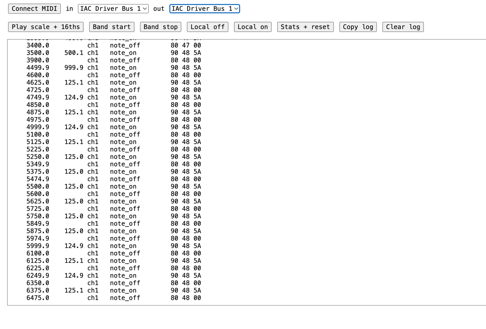
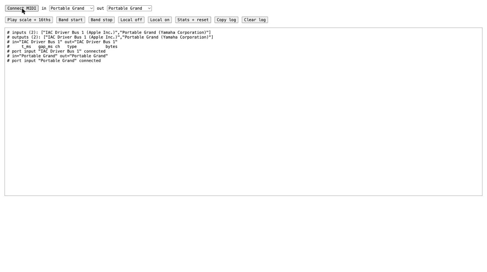

# The story so far

How Étude got built (it was called Piano Arcade until [#669]), one chapter per turning point. These are working
notes for the Devpost write-up and the "how it's made" part of the video. Every claim links to evidence in the repo.
A chapter records only what happened and what was measured: no recreated moments, no made-up numbers. Times are
Eastern (EDT), from git commit times or GitHub's merge times.

**The thread: Veritas, an honest machine.** The game is honest about your playing: a judge that marks only real
mistakes, test players that plant mistakes to prove it, and a mode that judges what a listener would hear. The build
was honest about itself: specs as the source of truth, CI and `verify.py` as the judge of "done", and incidents
written down when we got it wrong. Working line: *we built a game that tells you the truth, and a process that told
us the truth.*

Each chapter says who it's for: **judges** (the Devpost story), **team** (what we each did), **postmortem** (what to
keep or change next time). Each person's chapter is theirs to correct.

## Chapter 1: Will the piano even talk to us?

Readers: judges · team

*2026-10-23, evening. Eric at a Yamaha DGX-660 with a USB cable. Claude Code ran the terminal and Chrome and read the
logs. Evidence: [RESULTS.md](../spikes/piano-midi/RESULTS.md).*

The whole idea rests on one bet. A laptop can hear every key a player presses, with millisecond timing, and can make
the same piano play notes and a band. If that's false, nothing else matters, so we tested it before writing any more
spec.

**The plan was boring on purpose.** We tested in layers: macOS, then a Python script, then a plain HTML page in
Chrome. We proved the code on macOS's virtual MIDI port (the IAC Driver) before touching the piano, so piano time
only answered piano questions. The fallbacks were written down before the run: a local bridge if Chrome failed,
laptop speakers if the piano couldn't play. If the piano couldn't read keys, we would stop and rethink.

**Snags before a single note:**
- The MIDI library (`python-rtmidi` 1.5.8) ships no build for the laptop's Python 3.15, or even 3.13. Its newest is
  for 3.12, so the script runs on 3.12.
- The browser built into the Claude desktop app refuses Web MIDI outright. The Chrome tests ran in real Chrome.
- The first draft PR got marked "merged" by GitHub before it had any code. It was cut from the spec branch, and when
  the spec merged, GitHub counted it as merged too and closed the issue. We reopened the issue and opened a new PR.

**Virtual port first.** Python sent a scale and 16 fast notes and got all 24 back. Python's sleep-based sending
spread the fast notes 121 to 128 ms apart (target 125). Chrome schedules each note ahead of time, and its notes came
back exactly 125.0 ms apart.

**The piano shows up as a charger.** The first time it was plugged in, the Mac saw a 3 W USB charger and no MIDI.
The cable was in the piano's USB TO DEVICE port. Moved to USB TO HOST, it appeared as **"Portable Grand"** by Yamaha
Corporation, one MIDI port each way. It ran through a USB hub dongle, which the manual says to avoid. That made the
next test matter more.

**First keys.** Middle C pressed softly came in at velocity 50, pressed hard at 102. The sustain pedal surprised us:
instead of one on/off message, it sends a ramp of values about 6 ms apart, and on two channels at once.

**The number that matters.** A rhythm game falls apart if the piano or the USB link bunches notes together. In a run,
Eric grazed two neighbouring keys at once. They arrived **3.1 ms apart, as two separate events**, through the hub.
Chords came in note by note, 0.4 to 17 ms apart, in the order the hand rolled them.

**The laptop plays the piano.** Python sent a C-major scale and 16 fast notes to the piano's own speakers. Eric's
verdict: "yup it worked!" The 16ths sounded even. Then the band: drums on channel 10 and a finger bass on channel 2,
with Eric playing a scale over them. His keys kept arriving (29 notes, all on channel 1). The piano never sent the
band's notes back, so the game won't mistake the band for the player. Stopping the band mid-bar left silence, with no
stuck notes.

**The mute trick works.** One message (Local Control off) turned the piano's speakers off while every key still
reached the laptop. Another brought the sound back. That means the game can decide what the piano sounds like.

**The Chrome mystery.** In Chrome, a full round of key tests logged almost nothing, twice. The first theory was that
pressing the sustain pedal stalls Chrome's MIDI input, since the log went quiet just where the pedal came next. We tested it properly,
with Python and Chrome listening to the same piano at the same time. Over 158 seconds both saw exactly 116 notes and
536 pedal messages. Their timing agreed within 1 ms for 114 of 115 gaps, and the two clocks drifted 2.4 ms over the
whole run. The pedal theory was wrong. The real cause is still unknown; a second Chrome tab on the same port was
involved the first time. It's written up as an open risk, not swept under the rug.

**Verdict:** all seven requirements pass, in Python and in Chrome. No fallback is needed. The piano reads, the piano
plays, the piano can be muted, and the timing holds to about a millisecond.

### Material for the video

- Screenshots: [the IAC loopback in Chrome](../spikes/piano-midi/screenshots/01-chrome-iac-loopback.webp) and
  [the page connected to the piano](../spikes/piano-midi/screenshots/02-chrome-connected-to-piano.jpg).
- Raw logs to show on screen:
  - [Python on the piano](../spikes/piano-midi/python-piano.log): the soft/hard middle C, the pedal ramp and the
    3.1 ms pair are all in it.
  - [Python on the IAC port](../spikes/piano-midi/python-iac.log).
- Beats that work on camera:
  - the piano appearing as a "3 W charger";
  - the 3.1 ms pair;
  - the laptop playing the piano;
  - the silent keys still logging;
  - the pedal theory killed by a side-by-side test.
- Not captured at the time: video or audio of the piano playing. Film it fresh and label it as a re-run.

## Chapter 2: The swarm

Readers: judges · team · postmortem

*Friday 2026-10-23, 20:39, to Saturday night. Evidence: git history, [AGENTS.md](../AGENTS.md),
[decision 002](../specs/decisions/002-overnight-planner.md).*

**The rules came three minutes after the first commit.** The repo starts at [`2ca2c03`] (Fri 20:39). At 20:42,
[`2e8f182`] installed agent-brigade: the rules every coding agent here follows. The first PR merged at 21:11 ([#1]),
and the MIDI spike from chapter 1 at 21:22 ([#5]).

**One rule made the rest work: a feature is done only when its done note is on `main`.** Not when an agent says so.
Each note has to say how to check the feature, or say "not verified" and what's missing ([AGENTS.md](../AGENTS.md),
"The loop"). Specs in `specs/` are the source of truth, not chat or memory.

**Lanes, then a night shift.** At Sat 00:02, [`a5a7dc5`] split the work into lanes, one per person, each with its own
folder. At 02:28, [#34] added an overnight planner. Its decision record opens with the reason:
"Eric goes to bed soon." ([002](../specs/decisions/002-overnight-planner.md)).

**Saturday, by GitHub's merge times:**

- 379 PRs merged on Saturday. The busiest hour was 11:00 to 12:00, with 35.
- The median PR went from opened to merged in about 7.6 minutes (all 413 merged PRs, counted Sun 01:40).
- 108 features had a done note on `main` by midnight, and 113 by [`38f95bd`] (Sun 01:37).
- Eric's coding agents were numbered workers. By the `Worker:` line in each merged PR's body (counted Sun 01:40), the
  busiest four had 82, 75, 70 and 56 merged PRs, and the planner 39. Sharan's worker had 16.

**Why it matters for the thread.** A swarm that fast could report anything. What kept it honest was that "done" was a
file on `main` with a check in it, not a claim in a chat.

### Material for the video

- `/how`, once merged, draws merges per hour and who did what, from the same data ([how-it-works spec](../specs/features/how-it-works/spec.md)).
- `/operator` is the live board of features and PRs.
- Beat: "Eric goes to bed soon" as the reason for a night shift of agents.

## Chapter 3: The machine fights back

Readers: team · postmortem

*Saturday 2026-10-24, morning to night. Evidence: [#407], [#408], [#413], [#415], [#544],
[ci-browser's done note](../changes/ci-browser.md).*

**One laptop, six agents, dozens of browsers.** Every headless check started its own `next dev` and its own headless
Chromium. With up to 6 agents doing that on Eric's 8-core Mac, the load sat at 20 to 31 ([#407]). During one run on
[#408], it rose from 123 to 216. The first run of that check failed: 11 notes judged MISS, from late delivery under
load. The same commit passed on the second run.

**The decision.** Eric chose to move the heavy checks to GitHub's machines: "Rigor while lightening the load on the
local machine" ([#407]). [#413] (11:27) taught the check runner to shard and retry. [#415] (13:36) added the
`browser` job on GitHub, 4 shards at first and then 8. [#544] (21:15) made it a rule: one local headless check at a
time, and CI does the heavy runs.

**Honest about flakes and old failures.** A check that passes only on its rerun is reported `flaky`, not `pass`. A
check already red on `main` runs as `known red #N`, with its issue number, and doesn't block other PRs ([#433],
11:54). That list was empty again at [`cac584d`] (Sun 00:39).

**Measured after:** every check (56 of them) takes 16.4 to 17.3 minutes on `main`. An ordinary PR takes about 2
minutes (1.9 and 2.3) ([done note](../changes/ci-browser.md)).

### Material for the video

- The `plan` and `browser (n)` jobs on any PR's Checks tab.
- Beat: the load average climbing from 123 to 216 while one check ran.

## Chapter 4: The stale build

Readers: judges · team · postmortem

*Saturday 2026-10-24, 02:32 to 12:43. Evidence:
[the incident log](incidents/2026-10-24-stale-playtest-build.md).*

**"It works, and it works great."** That was Eric at about 11:00, after a live check. Then at about 11:35, he kept
pressing Esc in a song and nothing happened. Esc-to-pause had been on `main` since 04:44.

**What had happened.** The build he played was [`254891c`], from 02:32: about 9 hours old and 233 commits behind
`main`. A job meant to keep the main checkout on `origin/main` skipped, because of a local `.gitignore` edit, **17
times in a row** from 03:05 to 11:05. Only its own log said so. The "live check" covered 7 of the 82 finished
features.

**What we did.** We wrote it down the same morning, severity "no harm done, maximum embarrassment"
([#436], 11:56). Agents now read state from a fresh `origin/main`, never the main checkout ([#425], 11:56). The home page
now shows its short commit and age in a corner ([#434], 12:43).

**Why it matters for the thread.** The process caught its own lie: a "works great" that was true of a build nobody
was shipping.

### Material for the video

- The build stamp in the corner of `/`.
- The incident log's timeline: 17 skips in a row, then "It works, and it works great."

## Chapter 5: Main went red, and we said so

Readers: team · postmortem

*Saturday 2026-10-24. Evidence: the issues labeled `main-red`.*

**Two PRs, one red `main`.** [#387] and [#391] merged 24 seconds apart at 10:59. Together they broke a test:
a lane test still expected 6 black keys, and the new keyboard showed 10 ([#396]). [#397] fixed it at 11:04.

**The merge train.** On Saturday afternoon, the planner landed six PRs "within two minutes, without retesting each
against the new main" ([#532]). Two checks went red.

**What changed.** A red `main` gets an issue labeled `main-red`, and nothing merges until the fix does. Eight issues
reported a red `main` on Saturday: [#88], [#396], [#532], [#563], [#566], [#590], [#594], [#596]. When CI was busy,
the same label held merges back ([#573]) or let a named few through ([#579]).

### Material for the video

- Beat: two PRs merged 24 seconds apart, and together they turned `main` red.

## Chapter 6: Veritas, the judge on trial

Readers: judges · team

*Saturday 2026-10-24, 13:31 to 20:43. Evidence: [#514], [#542],
[veritas's done note](../changes/veritas.md), [players.test.ts](../web/src/veritas/players.test.ts).*

**The question.** Does the game's judge mark real mistakes, and only real mistakes? The idea was in the original
write-up: a planted take must produce "exactly two red marks, in the right places"
([writeup](../specs/context/raw/piano-arcade-writeup.md)).

**The answer, on the page.** `/veritas` ([#542], 20:43) runs five test players on real songs: Golden, Rusher, Jitter,
Fumbler and Chord Roller. Each plants known mistakes. The same judge that `/play` uses then finds them. On Für Elise,
Golden reads **2 planted, 2 found, 0 false alarms**. Every player on all 10 committed songs finds exactly what it
planted, with 0 false alarms ([done note](../changes/veritas.md)).

**It shows what it can't do.** Rusher plays too fast, and the judge has no measure for rushing. The page shows that
gap instead of hiding it ([#545], open). The tests also prove that a missed mistake and a false alarm would each show
up ([players.test.ts](../web/src/veritas/players.test.ts)).

**Below the judge,** a dashboard shows `main`'s last CI run. Anything CI didn't keep reads `unknown`. [#605] restyled
the page for the video.

### Material for the video

- `/veritas`: "2 planted, 2 found, 0 false alarms" on Für Elise.
- Beat: the Rusher card, a gap the page admits.

## Chapter 7: The impossible song

Readers: judges · team

*Saturday night, 23:14, to Sunday 00:14. Evidence: [#618],
[flow-mode's spec](../specs/features/flow-mode/spec.md), [#625], [flow-mode's done note](../changes/flow-mode.md).*

**A real pianist couldn't pass.** Eric played Flower Dance on the DGX and called strict mode "completely
undemoable". As relayed in [#618], he scored 10 to 20%, got lost, and couldn't rejoin because the song had
already moved on.

**The audience rule.** Eric's point: listeners forgive a lot, and "most people won't even notice if you're a little
off in dynamics or your tempo" ([spec](../specs/features/flow-mode/spec.md)). They do notice wrong notes and
stopping.

**Flow mode.** The plan merged at 23:21 ([#620]), and the mode at 00:14 ([#625]), wired into `/play` by [#629]. The
song waits at each note and follows the player's tempo, 0.5 to 1.3 times the chart's. It's scored on wrong notes,
skipped notes and stops, not timing. Its browser check passes 9 of 9.

**Not yet true:** Eric hasn't played it on the piano. That check is his ([done note](../changes/flow-mode.md)). If it
isn't solid by Sunday noon, the video falls back to right hand only ([#618]).

### Material for the video

- Strict mode's 10 to 20% next to a Flow take of the same song, once Eric records one.

## Chapter 8: Sharan's lane: saving takes, lighting keys

Readers: judges · team

*Saturday to Sunday. Sharan ([@iKnow24](https://github.com/iKnow24)): 30 PRs, 24 merged. Evidence: [#660],
[take-store's done note](../changes/take-store.md), [firmware/RESULTS.md](../firmware/RESULTS.md).*

**The backend.** Sharan's lane is the database, accounts, the progress page and the LED strip. At 03:03 Saturday,
[#59] chose Supabase for take history. The take store landed at 11:29 ([#61]), the sign-in screen at 12:27
([#467]), and the account chip on the menu after it ([#471]). [#405] (11:28) got the app ready for Vercel.

**Live, by [#660]:** guests by default and Google sign-in; every finished take saved and re-judged on the server; a
profile page; a limit of 20 saves per player per 5 minutes. All 10 committed songs save and read back, 14 of 14 abuse
checks are blocked, and 8 of 8 live smoke checks pass.

**The browser never writes.** Only server routes write to the database, and every migration runs through a test that
fails on a table without row-level security ([supabase/README.md](../supabase/README.md)).

**The lights.** [#40] (Sat 02:33) brought the LED strip back into the plan. The firmware and a standalone tester
landed at 15:46 ([#340]). First light on the piano came Sunday at 00:53 ([#639]), and a page to play the strip with
no piano at 00:55 ([#654]). The game side, lighting the next key and every hit, is [#569] by eric-agent-5. The results
file's own rule: "Empty cells are not run yet; nothing here is estimated." ([RESULTS.md](../firmware/RESULTS.md)).

### Material for the video

- The strip lighting the next key on the DGX.
- `/progress` after a few takes.

## Chapter 9: Andres and the tutor: becoming Étude

Readers: judges · team

*Saturday 03:41 to Sunday 01:28. Andres ([@seeko-codes](https://github.com/seeko-codes)). Evidence:
[PRODUCT_PHILOSOPHY.md](../PRODUCT_PHILOSOPHY.md), [the dialogue](../specs/context/dialogues/2026-10-25-what-are-we-building.md),
[naming.md](../specs/context/naming.md).*

**The learning side.** Andres's first commit, [`dc78ee7`] (Sat 03:41), added score-first learning workspaces. [#343]
(10:51) and [#390] (11:29) built the learning preview.

**A philosophy, frozen.** [#608] (Sat 22:01) added [PRODUCT_PHILOSOPHY.md](../PRODUCT_PHILOSOPHY.md), "Frozen by the
user on 2026-10-24": six principles, the first being "Resolve feeling lost."

**From Piano Arcade to Étude.** In the small hours, Eric and Andres worked out what they were building. The record of
it calls itself "a distilled reconstruction of one working session, not a transcript" ([#640], 00:44). Then came the
visual direction, Duo ([#636], 00:46), its pink ([#663], 01:04), and the name ([#669], 01:28). Eric, relaying the team:
"They all love it. We're going with Étude!" ([naming.md](../specs/context/naming.md)).

### Material for the video

- The name change as a moment: the arcade becomes a tutor.

## Chapter 10: From outside the team

Readers: team

*Evidence: [#92], [#600].*

[@abbasi2010](https://github.com/abbasi2010) opened two PRs. [#92], a plan for a UI foundation, was closed by Eric:
"features implemented partially, PR is stale now." [#600] (Sat 20:25) proposes scoring policy v3: new timing windows
(±31.25 ms PERFECT to ±125 ms GOOD), credit for held notes and clearer early/late feedback, 1,530 added
lines. It is open, and its CI was failing when this was written.

## Timeline

| When (EDT) | What | Evidence |
|---|---|---|
| Fri 20:39 | First commit | [`2ca2c03`] |
| Fri 20:42 | agent-brigade installed: the rules | [`2e8f182`] |
| Fri 21:22 | The piano talks: MIDI spike merged | [#5] |
| Sat 00:02 | Lanes, one per person | [`a5a7dc5`] |
| Sat 02:28 | Overnight planner | [#34] |
| Sat 02:32 | The build Eric would playtest 9 hours later | [`254891c`] |
| Sat 03:03 | Supabase chosen for take history | [#59] |
| Sat 03:41 | Andres's first commit | [`dc78ee7`] |
| Sat 10:59 | #387 and #391 merge 24 s apart; `main` goes red | [#396] |
| Sat 11:00–12:00 | Busiest hour: 35 PRs merged | GitHub merge times |
| Sat 11:29 | Take store | [#61] |
| Sat 11:56 | Stale-build incident written up; agents read fresh `origin/main` | [#436], [#425] |
| Sat 12:43 | Build stamp | [#434] |
| Sat 13:36 | Headless checks move to GitHub | [#415] |
| Sat 15:46 | LED strip firmware | [#340] |
| Sat 20:43 | Veritas: 2 planted, 2 found | [#542] |
| Sat 21:15 | One local headless check at a time | [#544] |
| Sat 22:01 | Product philosophy | [#608] |
| Sat 23:14 | Flower Dance: "completely undemoable" | [#618] |
| Sun 00:14 | Flow mode | [#625] |
| Sun 00:39 | No known-red checks left | [`cac584d`] |
| Sun 00:53 | First light on the piano | [#639] |
| Sun 01:28 | The product is Étude | [#669] |

[#1]: https://github.com/Eric-Zhang-Developer/piano-arcade-gator-ai-days/pull/1
[#5]: https://github.com/Eric-Zhang-Developer/piano-arcade-gator-ai-days/pull/5
[#34]: https://github.com/Eric-Zhang-Developer/piano-arcade-gator-ai-days/pull/34
[#40]: https://github.com/Eric-Zhang-Developer/piano-arcade-gator-ai-days/pull/40
[#59]: https://github.com/Eric-Zhang-Developer/piano-arcade-gator-ai-days/pull/59
[#61]: https://github.com/Eric-Zhang-Developer/piano-arcade-gator-ai-days/pull/61
[#88]: https://github.com/Eric-Zhang-Developer/piano-arcade-gator-ai-days/issues/88
[#92]: https://github.com/Eric-Zhang-Developer/piano-arcade-gator-ai-days/pull/92
[#340]: https://github.com/Eric-Zhang-Developer/piano-arcade-gator-ai-days/pull/340
[#343]: https://github.com/Eric-Zhang-Developer/piano-arcade-gator-ai-days/pull/343
[#387]: https://github.com/Eric-Zhang-Developer/piano-arcade-gator-ai-days/pull/387
[#390]: https://github.com/Eric-Zhang-Developer/piano-arcade-gator-ai-days/pull/390
[#391]: https://github.com/Eric-Zhang-Developer/piano-arcade-gator-ai-days/pull/391
[#396]: https://github.com/Eric-Zhang-Developer/piano-arcade-gator-ai-days/issues/396
[#397]: https://github.com/Eric-Zhang-Developer/piano-arcade-gator-ai-days/pull/397
[#405]: https://github.com/Eric-Zhang-Developer/piano-arcade-gator-ai-days/pull/405
[#407]: https://github.com/Eric-Zhang-Developer/piano-arcade-gator-ai-days/issues/407
[#408]: https://github.com/Eric-Zhang-Developer/piano-arcade-gator-ai-days/pull/408
[#413]: https://github.com/Eric-Zhang-Developer/piano-arcade-gator-ai-days/pull/413
[#415]: https://github.com/Eric-Zhang-Developer/piano-arcade-gator-ai-days/pull/415
[#425]: https://github.com/Eric-Zhang-Developer/piano-arcade-gator-ai-days/pull/425
[#433]: https://github.com/Eric-Zhang-Developer/piano-arcade-gator-ai-days/pull/433
[#434]: https://github.com/Eric-Zhang-Developer/piano-arcade-gator-ai-days/pull/434
[#436]: https://github.com/Eric-Zhang-Developer/piano-arcade-gator-ai-days/pull/436
[#467]: https://github.com/Eric-Zhang-Developer/piano-arcade-gator-ai-days/pull/467
[#471]: https://github.com/Eric-Zhang-Developer/piano-arcade-gator-ai-days/pull/471
[#514]: https://github.com/Eric-Zhang-Developer/piano-arcade-gator-ai-days/issues/514
[#532]: https://github.com/Eric-Zhang-Developer/piano-arcade-gator-ai-days/issues/532
[#542]: https://github.com/Eric-Zhang-Developer/piano-arcade-gator-ai-days/pull/542
[#544]: https://github.com/Eric-Zhang-Developer/piano-arcade-gator-ai-days/pull/544
[#545]: https://github.com/Eric-Zhang-Developer/piano-arcade-gator-ai-days/issues/545
[#563]: https://github.com/Eric-Zhang-Developer/piano-arcade-gator-ai-days/issues/563
[#566]: https://github.com/Eric-Zhang-Developer/piano-arcade-gator-ai-days/issues/566
[#569]: https://github.com/Eric-Zhang-Developer/piano-arcade-gator-ai-days/pull/569
[#573]: https://github.com/Eric-Zhang-Developer/piano-arcade-gator-ai-days/issues/573
[#579]: https://github.com/Eric-Zhang-Developer/piano-arcade-gator-ai-days/issues/579
[#590]: https://github.com/Eric-Zhang-Developer/piano-arcade-gator-ai-days/issues/590
[#594]: https://github.com/Eric-Zhang-Developer/piano-arcade-gator-ai-days/issues/594
[#596]: https://github.com/Eric-Zhang-Developer/piano-arcade-gator-ai-days/issues/596
[#600]: https://github.com/Eric-Zhang-Developer/piano-arcade-gator-ai-days/pull/600
[#605]: https://github.com/Eric-Zhang-Developer/piano-arcade-gator-ai-days/pull/605
[#608]: https://github.com/Eric-Zhang-Developer/piano-arcade-gator-ai-days/pull/608
[#618]: https://github.com/Eric-Zhang-Developer/piano-arcade-gator-ai-days/issues/618
[#620]: https://github.com/Eric-Zhang-Developer/piano-arcade-gator-ai-days/pull/620
[#625]: https://github.com/Eric-Zhang-Developer/piano-arcade-gator-ai-days/pull/625
[#629]: https://github.com/Eric-Zhang-Developer/piano-arcade-gator-ai-days/pull/629
[#636]: https://github.com/Eric-Zhang-Developer/piano-arcade-gator-ai-days/pull/636
[#639]: https://github.com/Eric-Zhang-Developer/piano-arcade-gator-ai-days/pull/639
[#640]: https://github.com/Eric-Zhang-Developer/piano-arcade-gator-ai-days/pull/640
[#654]: https://github.com/Eric-Zhang-Developer/piano-arcade-gator-ai-days/pull/654
[#660]: https://github.com/Eric-Zhang-Developer/piano-arcade-gator-ai-days/issues/660
[#663]: https://github.com/Eric-Zhang-Developer/piano-arcade-gator-ai-days/pull/663
[#669]: https://github.com/Eric-Zhang-Developer/piano-arcade-gator-ai-days/pull/669
[`254891c`]: https://github.com/Eric-Zhang-Developer/piano-arcade-gator-ai-days/commit/254891c
[`2ca2c03`]: https://github.com/Eric-Zhang-Developer/piano-arcade-gator-ai-days/commit/2ca2c03
[`2e8f182`]: https://github.com/Eric-Zhang-Developer/piano-arcade-gator-ai-days/commit/2e8f182
[`38f95bd`]: https://github.com/Eric-Zhang-Developer/piano-arcade-gator-ai-days/commit/38f95bd
[`a5a7dc5`]: https://github.com/Eric-Zhang-Developer/piano-arcade-gator-ai-days/commit/a5a7dc5
[`cac584d`]: https://github.com/Eric-Zhang-Developer/piano-arcade-gator-ai-days/commit/cac584d
[`dc78ee7`]: https://github.com/Eric-Zhang-Developer/piano-arcade-gator-ai-days/commit/dc78ee7
