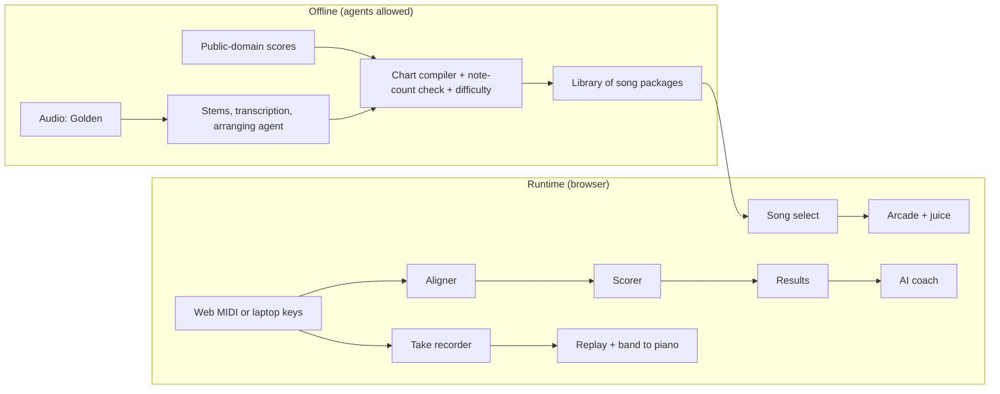

# Piano Arcade (v4)

*Earlier versions are kept and untouched:*
- *v1: `handoff.md`, the any-song tutor.*
- *v2: `piano-arcade-v2.md`, the first arcade version.*
- *v3: `piano-arcade-v3.md`, Mozart's variations as levels.*
- *Research: `competitors.md`. Team brief: `writeup/piano-arcade.html`.*

**What changed from v3:**
- **The library is the product; Twinkle is the hook.** Mozart's variations are not the game's levels. Eric read the score: they don't stack into a difficulty ladder. The app plays a **classical library**: about 20 pieces to start, growing toward 100, plus a few pop songs.
- **Twinkle → Var. XII is only the video's story beat.** Everyone knows Twinkle; Mozart's last variation on it is brutal. That's all it has to do.
- **Count only what's tested.** Every piece passes a note-count check against its own score, or it doesn't ship.
- **Difficulty comes from the music.** Each piece gets a computed difficulty rating, which replaces the fake level ladder.
- **Song select replaces the level map.** A 3-second scroll through the library joins the pitch.

---

## Abstract

**The pitch:** A Japanese-style piano arcade on a real piano that's also a real way to practice. Pick a piece from a classical library, and every note gets judged. An AI coach tells you how you played, and any song you love can become a level.

**What it is / isn't:** Konami's piano arcade games crossed with Guitar Hero, played on a real Yamaha. Loud and juicy enough to be fun, honest enough to make you better. A browser version plays on laptop keys. It is not another quiet piano-tutor app, and it is not a chatbot.

**Who it's for:** Anyone at a keyboard who wants to get better while having fun. The library runs from Twinkle and Bach's C-major Prelude up to Chopin, with a difficulty rating on every piece. A few pop songs keep people coming back. The judges are users too: they can play in the browser.

**The problem:** Practicing piano is lonely and quiet. Feedback is either "right note or wrong note" or a teacher who costs money and isn't there at 11 PM. Arcade rhythm games are the opposite: loud, instant and addictive. But they don't teach a real instrument.

**Closest thing that exists:**
- Konami's Keyboardmania and Nostalgia 🔍: our inspiration, but not built for learning.
- Melodics: grades timing against a fixed click.
- Piano Marvel: the most respected learning app, but dry, and it doesn't grade dynamics.

Our edge: arcade energy *and* real feedback, an AI coach, any song as a level, and the real piano playing your take back. More in `competitors.md`.

**The demo moment:** Two of them.
- **The opening:** a real piano lighting up like an arcade machine.
- **The closing:** a song the judges know comes out of the piano as a full band while a human plays the melody in the game.

**Riskiest bets:**
1. **The DGX-660 round trip through Chrome's Web MIDI is fast and stable enough for millisecond judgments.** Test it first. Pass if the latency is a stable offset we can calibrate out ⚠️.
2. **The "Golden" level sounds good.** Pass if someone who hasn't heard the plan recognizes it within 5 seconds ⚠️. If it fails, the video ends on the Var. XII beat.

**Tracks:** First place, Best AI Hack, Best Design, Best Use of Gemini, Best Use of ML (DSI), Best Social Impact.

**Why us, why this:** 👤 Unanswered.

**Status and next step:** Picked as v4. Next: the piano test, and the seed list of pieces.

---

## Ground Rules

- **All classical, all public domain.** The library comes from public-domain scores. No time spent on licensing. The "Golden" level is a demo feature; the team accepts that risk. No copyright hedging anywhere.
- **Software is cheap.** Build as much as we can, make it testable, and run many agents. Humans own the piano, taste, the video and the stage.
- **Long-horizon agents run before, never live.** Transcription, charting and arranging happen offline. The only live AI call is the coach, one request per take.
- **Maybe, not cut.** Maybe items get built when a lane frees up, and never block the two wows.
- **Count only what's tested.** A piece that fails its check is dropped, never shown. Any number we show is a real count.
- **All project code is written during the event** (a Gator Hack rule). Installable kits like agent-brigade are fine. Past projects (the Knight Hacks Foreman page, the SUPER 1776 renderer, the Fantasy Impromptu pipeline) get rebuilt fresh: same ideas, new files.

## How We Sell It

1. **It's an arcade.** Loud, juicy, instantly fun, on a real piano.
2. **It actually teaches you.** Every note judged, your take played back, a coach that tells you what to fix. Twinkle to Chopin, with a difficulty rating on every piece.
3. **AI does the parts a person can't.** A coach that reads your playing, and agents that turn any song into a level.

## The Two Wows and the Hook

- **Opening wow, first 10 seconds: a real piano that plays like an arcade machine.** It plays the Twinkle theme: hands on real keys, the highway lit, PERFECT after PERFECT, an S rank.
- **Closing wow: a song you know becomes a level.** "Golden" goes in. The offline agents turn it into a chart, and the piano plays it with drums and bass while a human plays the melody.
- **The hook in between is Twinkle, not a third wow.** *"Everyone knows Twinkle. Mozart wrote twelve variations on it. The last one is brutal."* Then *"I can't play this yet. That's the point."* It's the human moment, and it's our Impact argument in one line.

Nothing else gets screen time in the pitch unless it gets a reaction.

## The Pitch Video (2–3 minutes)

Production details (cameras, animation) are deferred.

| Time | What the judge sees and hears |
|---|---|
| 0:00 | **Opening wow.** Dark room, glowing highway over real keys, the Twinkle theme. PERFECT ×12, combo bursts, announcer, S rank. Title: **Piano Arcade** |
| 0:12 | Song select scrolls through the library: Bach, Beethoven, Debussy, Chopin, each with a difficulty rating. About 3 seconds, no words |
| 0:16 | **The loop, once.** A take of Für Elise with one LATE, the results screen, the coach's line, then the piano plays the take back with the slip glowing red |
| 0:40 | Montage: harder pieces, the highway denser, grades climbing |
| 1:00 | *"Everyone knows Twinkle. Mozart wrote twelve variations on it. The last one is brutal."* WARNING card. Eric at 50% against his ghost: *"I can't play this yet."* The piano takes it at full speed: *"That's the point."* |
| 1:25 | *Any song.* The offline agents take a recording apart into a chart, about 8 seconds |
| 1:35 | **Closing wow.** "Golden" with the band out of the piano, a human on the melody, judgments popping |
| 1:50–2:30 | End card and QR code to the browser version. Room to breathe if the cut runs long |

Captions instead of voiceover, and music the whole way. Record the piano's line-out directly.

## The Deep Dive (2–4 minutes, after the pitch)

Chapters with titles and timestamps, each 20–40 seconds:
- **How it feels:** the juice up close.
- **The coach:** three takes, three different pieces of advice.
- **The timing line:** rubato vs. slips.
- **The library:** how a public-domain score becomes a tested chart with a difficulty rating.
- **Meet the synthetic pianists:** the test harness as characters.
- **How we built it:** the agent-brigade setup and a build replay.
- **Play it anywhere:** laptop keys.
- *(Maybe)* **The lights:** the LED strip.

## The Stage Version (finals, about 6 minutes)

1. The live opening wow.
2. A song-select flick.
3. Results, coach and replay.
4. The Var. XII clip from the video.
5. The live "Golden" level.
6. One image of how we built it.

Stop at about 3½ minutes. The depth lives in Q&A.

## The Library

**The target:** about 20 tested pieces, spanning easy to hard, then more as they pass. A few pop songs, through the offline agents.

**How a piece gets in** (the chart compiler, one generic pipeline):
1. A public-domain score (MusicXML or LilyPond from Mutopia, IMSLP or MuseScore 🔍) goes in.
2. The compiler writes a chart with notes, hands, bars, dynamics and tempo.
3. **Note-count check:** the chart must match the score's own MIDI note for note, the same check that verified all 3,014 notes in Fantasy Impromptu. Fail means dropped.
4. **Difficulty rating, computed** from notes per second, hand stretch, how much the hands overlap, and the tempo. It's shown as 1–5 ⚠️, with the formula tuned by playing a few pieces.

**Seed list** ⚠️ (proposed; Eric picks favorites, agents fill the rest):

| Easy | Medium | Hard |
|---|---|---|
| Twinkle theme (Mozart, K. 265) | Für Elise (Beethoven) | Nocturne Op. 9 No. 2 (Chopin) |
| Prelude in C, BWV 846 (Bach) | Invention No. 1, BWV 772 (Bach) | Moonlight Sonata, 3rd mvt (Beethoven) |
| Minuet in G, BWV Anh. 114 (Petzold) | Sonata K. 545, 1st mvt (Mozart) | Rondo alla Turca, K. 331 (Mozart) |
| Gymnopédie No. 1 (Satie) | Prelude Op. 28 No. 4 (Chopin) | Fantaisie-Impromptu, Op. 66 (Chopin) |
| Sonatina Op. 36 No. 1 (Clementi) | Clair de Lune (Debussy) | Twinkle Var. XII (Mozart, K. 265) |
| Arabesque, Op. 100 No. 2 (Burgmüller) | Träumerei, Op. 15 No. 7 (Schumann) | Ballade No. 1, coda (Chopin) |
| Melody, Op. 68 No. 1 (Schumann) | Pathétique, 2nd mvt (Beethoven) | |

The difficulty columns are rough guesses ⚠️. The computed rating replaces them.

## Juice

The arcade feel runs on the laptop's speakers and screen. The piano stays the music.

**Sound:**
- Hit sounds pitched to the piece's key, short and quiet.
- Combo stingers at 25, 50 and 100.
- An announcer (voice 👤 Unanswered).
- A drumroll and fanfare for the grade.
- A siren for the WARNING card.
- **Mix rule:** effects duck under the piano. Loud ones only land at phrase ends and on results.

**Visual:**
- Hit bursts, and screen shake on combo milestones.
- Fever mode at a 50 combo (gold highway, rising sun).
- The grade reveal and a neon ghost trail.
- The WARNING card before the hardest pieces.

**Rule:** juice never hides information. A judgment must be readable in a glance.

## The Weekend Version

**In:**
- **The arcade with juice.**
- **Song select:** the library with composer, difficulty and best grade.
- **The scoring engine:**
  - timing against your own tempo curve (rubato isn't punished)
  - chord sync
  - dynamics
  - a strict metronome mode
- **The AI coach:** two sentences and one drill, grounded in the scoring data.
- **Replay and ghost.**
- **The browser version** on laptop keys.
- **The library:** about 20 checked pieces, Twinkle Var. XII among them.
- **The "Golden" level,** prepared offline. Fallback: end on the Var. XII beat.

**Maybe:**
- LED strip
- a build-replay page for the deep dive
- animated story beats
- the coach listening to audio
- a local leaderboard
- more pieces (up to 100) and more pop songs

**Out:**
- Mozart's variations as a level ladder: they don't stack that way.
- An AI-written 13th variation.
- Live transcription on stage.
- An online leaderboard server.

## Look and Feel

- **Pixel art is the medium** ⚠️ (proposed; the SUPER 1776 lineage).
- **Classical is the story.** Song select reads like a concert program: piece, composer, catalog number. Real sheet music is on screen.
- **Synthwave is the light.**
- **The mascot is a gator dressed as Mozart.** Eric approved the concept image; the name is 👤 Unanswered.

## How It Works

**Scoring:**
- **Timing.** Judged against a smooth tempo curve fitted to your take, not against a click. Perfect is ±25 ms and Great is ±50 ms ⚠️.
- **Chord sync.** All the notes of a chord should land within about 30 ms of each other ⚠️.
- **Dynamics.** Key velocity against the score's dynamic markings.
- **Notes.** Right, wrong, missed or extra, from the alignment.

**The coach:**
- It gets the results JSON plus your last few takes, and returns two sentences and one drill.
- A check in code makes sure every bar and number it cites exists in the results. If one doesn't, it falls back to a plain summary.
- It runs on Gemini ⚠️.

## Agent Architecture and Testing

**Setup:** agent-brigade, hackathon profile, full size (`npx agent-brigade --profile hackathon --full`). `main` is protected, and there's a human checkpoint every 2–3 hours.

**Contracts, frozen before agents start:**
1. song package (chart, score, band channels, difficulty, check result)
2. input device
3. take
4. results
5. coach output
6. game events

**Lanes:**

| Lane | Owns |
|---|---|
| Chart compiler | Any public-domain score → song package; note-count check; difficulty rating |
| Library | The seed list: sourcing scores, running the compiler, dropping failures |
| Scoring engine | Aligner and scorer, as pure functions |
| Arcade UI | Song select, highway, judgments, results screen, pixel look |
| Juice | Sound, announcer, effects, fever |
| MIDI I/O | Piano in and out, replay, band, latency calibration |
| Coach | Prompt, grounding check, fallback |
| Song prep (offline) | "Golden": stems → transcription → arranging agent |
| Veritas | The test harness |

**Veritas, the test harness:**
- **The basics:** a mirror piano, plus synthetic pianists (Perfect, Rusher, Fumbler, Skipper, Rubato Player, Jitter Player, Chord Roller).
- **Golden test:** a take with 2 planted mistakes gets exactly 2 red marks.
- **Coach test:** every claim cites real data.
- **Juice test:** the right stingers fire, in the right order.
- **Chaos test:** no stuck notes.
- **New: the library check.** Every piece in the library passes its note-count check. The Perfect Player has to score 100% on every piece. A difficulty rating has to exist for each one.

## What's Already Out There

Konami's Keyboardmania and Nostalgia 🔍, Melodics, Rocksmith+ piano, Piano Marvel, Synthesia, and the learning apps (Simply Piano, Flowkey, Yousician, Playground Sessions). See `competitors.md`.

**What judges will assume we copied:** Guitar Hero.
**Our answer:** Guitar Hero teaches a plastic controller. This teaches a real instrument, tells you how you played, and plays your take back on your own piano.

## Tracks & Prizes

| Track | Prize | Fit | Tier |
|---|---|---|---|
| Main award | $2,000 / $1,000 / $500 | The whole project | 1 |
| Best AI Hack | $200 | Coach and song-prep agents | 1 |
| Best Design | $200 | The arcade identity and juice | 1 |
| Best Use of Gemini | MLH swag | Coach on Gemini | 2 |
| Best Use of ML (DSI) | TBA | Alignment, transcription, the difficulty model | 2 |
| Best Social Impact | $200 | Fun practice with real feedback | 2 |

## How It Plays With the Judges

All scores are ⚠️ guesses.

| Criterion | Guess | What a 5 rests on |
|---|---|---|
| Impact | 3–4 | A real library plus the I-can't-play-this-yet beat |
| Technicality | 4–5 | The two wows working cleanly; a tested library; the deep dive |
| Design | 5 | Pixel arcade, classical on top, readable juice |
| Novelty | 4 | The coach, the song-prep agents, an arcade on a real instrument |
| Presentation | 5 | Two wows in under 3 minutes |

## Stack & Budget

- **One web app** (TypeScript, canvas, pixel rendering ⚠️), with Web Audio for sound effects ⚠️ and Web MIDI in Chrome.
- **Sheet music:** OpenSheetMusicDisplay or Verovio ⚠️.
- **Offline (Python):** music21 for the chart compiler and the difficulty features. Demucs, Basic Pitch and an arranging agent for song prep.
- **Coach:** Gemini, behind one serverless function ⚠️.
- **Budget:** 👤 Unanswered.

## Team

Team: Eric, possibly his roommate, others 👤 Unanswered.

## What Could Break Live

| Risk | Countermeasure |
|---|---|
| The piano doesn't behave as documented | Test it first; calibration setting |
| Score files are messy (hands, repeats, ornaments) | The note-count check drops bad pieces; only checked pieces ship |
| Difficulty ratings feel wrong | Tune the formula by playing 5 pieces; show it as a rough 1–5 |
| Sound effects clash with the piano | Audio clock, pitch to the key, duck under the piano |
| "Golden" sounds bad | End on the Var. XII beat instead |
| An agent breaks scoring | Golden test and synthetic pianists on every PR |
| The piano isn't allowed on stage | Ask at the opening; fallback is the video plus laptop keys |

## Judge Questions

- **"Isn't this Guitar Hero for piano?"** Guitar Hero teaches a plastic controller. This teaches a real instrument and tells you how you played.
- **"How many songs?"** [N] classical pieces from public-domain scores, every one checked note for note, plus any song through the agents. (N is the real count at submission.)
- **"Where's the AI?"** A coach that reads your playing, and agents that turn any song into a level.
- **"Does it actually teach?"** It judges every note, plays your take back, and gives you one drill. Every piece is rated, so you can climb from Twinkle to Chopin.
- **"Can I try it?"** On laptop keys, at this QR code.
- **"Can you play Var. XII?"** Not yet. That's the point.

## What Counts as a Win

First place is the target. 👤 Unanswered: whether a top-10 finish plus a category prize also counts.

## Open Questions

- 👤 Eric's favorite pieces for the seed list
- 👤 Why this over the other ideas
- 👤 Team, roles, lanes; whether the roommate joins
- 👤 Whether any pre-event checks happened
- 👤 Names: game, mascot, announcer voice
- 👤 Budget and credits
- 👤 What counts as a win
- ⚠️ Pixel art as the medium
- ⚠️ Difficulty formula; timing windows; chord-sync threshold
- ⚠️ The "Golden" recognition test
- ⚠️ Rendering, audio and sheet-music libraries; coach on Gemini
- 🔍 Public-domain score sources for each seed piece
- 🔍 Keyboardmania and Nostalgia details; judging scale; piano on stage; what Twinly wants
