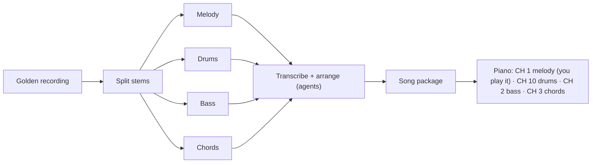
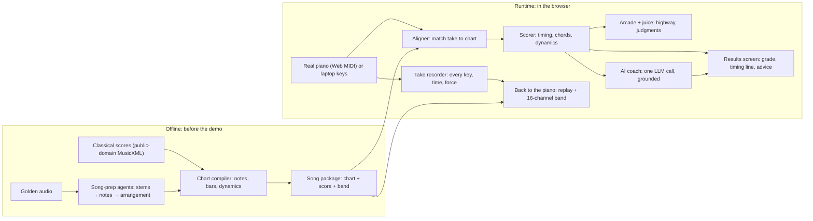

# Piano Arcade

A Japanese-style rhythm game on a real piano that actually teaches you. Every note is judged, a coach tells you how you played, and a classical library runs from Twinkle to Chopin.

This is the team brief for Gator Hack V in Markdown. It has the same content as `piano-arcade.html`, with the visuals written out as text. The detailed plan is `../piano-arcade-v4.md`, and competitor research is `../competitors.md`.

**Conventions:**
- ⚠️ marks a proposal or guess that still needs confirming.
- 👤 marks a decision only the team can make.
- Wireframe numbers are examples, not real data.

---

## Abstract

We're bringing a real 88-key Yamaha DGX-660 to Gator Hack V and turning it into an arcade machine. Notes fall down a neon highway toward the keys, and you play them on the actual piano. Every note gets a judgment (PERFECT, GREAT, EARLY, LATE), a combo builds, the screen and speakers pop, and you get a letter grade. It feels like the Japanese piano arcade cabinets and plays like Guitar Hero, except the instrument is real.

It's also a serious way to practice. You pick from a library of classical pieces, about 20 to start, from Twinkle and Bach up to Chopin, each with a difficulty rating computed from the music. After each take, the piano plays your take back with the mistakes marked. An AI coach then gives two sentences of real feedback and one drill, grounded in the scoring data.

The AI does what a person can't. The coach reads your playing. Before the demo, agents take a song everyone knows ("Golden") apart into stems, transcribe it and arrange it into a level. The piano then plays it with drums and bass while you play the melody.

The pitch has two wows and nothing else: the real piano lighting up like an arcade in the first ten seconds, and a hit song coming out of the piano as a full band at the end. Everything else (the scoring math, the coach's grounding check, the agent build) lives in a deep dive for judges who want more.

We build it with a crew of coding agents working from a shared spec. The plan is to ship a lot of tested software and show only the best of it. Round 1 is judged offline from our Devpost page and video. The top 10 pitch on stage at the finals.

---

## The setup

**Wireframe: the physical setup.**
- A real 88-key piano (Yamaha DGX-660) on an X-stand.
- A screen above the keys shows the note highway. Notes fall toward a judgment line, and a PERFECT burst pops where a note lands.
- The piano connects to a laptop by **one USB-MIDI cable**. Keys go to the laptop; replay and band playback come back to the piano.
- The laptop runs the game in Chrome and drives the screen.

---

## How we sell it

The same order everywhere: the video, the Devpost page, the stage. Judges remember the first thing they feel, so the first thing they feel is fun.

1. **Arcade: it's a game.** Loud, juicy, instantly readable, on a real piano.
2. **Teacher: it teaches you.** Every note judged, your take played back, one drill to fix it. Twinkle to Chopin.
3. **AI: it does the rest.** A coach that reads your playing, and agents that turn any song into a level.

---

## The two wows

A feature gets screen time in the pitch only if it gets a reaction. Projects blur together when they have default UIs and teams that talk about auth. Eric has seen it from the judging side. We have two wows.

| | Opening wow (first 10 seconds) | Closing wow (the ending) |
|---|---|---|
| **What** | A real piano that plays like an arcade machine | A song you know becomes a level |
| **On screen** | Hands on real keys, the highway lit, PERFECT after PERFECT, the combo climbing, an S rank | "Golden" goes in, agents turn it into a chart, and the piano plays it with drums and bass while a human plays the melody |
| **Judge reaction** | "Guitar Hero on a real piano," understood in three seconds | "I want *my* song" |

**How the closing wow works.** The song work happens offline, before the demo; the playback happens live, on stage.

The band comes out of the piano's own speakers, and you play the melody in the arcade.

---

## The library

The app plays real repertoire: about 20 public-domain pieces to start, growing toward 100 as they pass our checks, plus a few pop songs.

- **One chart compiler** turns any public-domain score into a playable chart.
- **Each piece must match its own score note for note,** or it's dropped and never shown.
- **Difficulty is computed from the music itself:** notes per second, hand stretch, how much the hands overlap, and tempo. So the rating on each piece means something.

**Wireframe: song select.**
- **Header:**
  - the title "Choose a piece"
  - filter chips: ALL (selected), CLASSICAL, POP
  - a sort control: DIFFICULTY
- **List rows:** each shows the piece, the composer and catalog number, a difficulty meter of 5 pips, your best grade, and a CHECKED badge. Example rows:

  | Piece | Composer | Difficulty | Best |
  |---|---|---|---|
  | Twinkle (theme) | Mozart · K. 265 | 1/5 | S |
  | Prelude in C | Bach · BWV 846 | 2/5 | A |
  | **Für Elise** (selected) | Beethoven · WoO 59 | 3/5 | B |
  | Gymnopédie No. 1 | Satie | 2/5 | — |
  | Clair de Lune | Debussy | 4/5 | — |
  | Golden | Pop · agent-arranged | 3/5 | — |
  | Twinkle, Var. XII | Mozart · K. 265 | 5/5 | — |

- **Preview panel** for the selected piece:
  - the title, composer and catalog number, and a strip of sheet music
  - difficulty, notes per second, hand stretch, your best grade
  - buttons: PLAY and PRACTICE 70%
- **Footer:** every piece shown passed its note check. The real library is whatever passes; never show a count you haven't verified.

### The hook: Twinkle

The video needs a story everyone gets instantly. Everyone knows Twinkle. Mozart wrote twelve variations on it (K. 265), and the last one is brutal. That's Mozart's only job in the pitch. In the app, Variation XII is just one hard piece in the library. The variations are **not** a level ladder.

> "I can't play this yet. That's the point."

That's our human moment. Eric plays Var. XII at 50% tempo against his own ghost, then the piano takes it at full speed by itself. It's honest, every judge relates to it, and it's our Impact argument in one line.

---

## The Devpost video

The pitch runs 2–3 minutes, then the deep dive. Round 1 judges skim many submissions. A judge who stops watching at 2:00 has still seen everything they need to rank us first. Captions instead of voiceover, music the whole way, and the piano recorded straight from its line-out.

| Time | What the judge sees and hears |
|---|---|
| 0:00 | **Opening wow.** Dark room, glowing highway over real keys, the Twinkle theme. PERFECT ×12, combo bursts, announcer, S rank. Title card. |
| 0:12 | Song select scrolls through the library: Bach, Beethoven, Debussy, Chopin, each with a difficulty rating. About 3 seconds, no words. |
| 0:16 | The loop, once. A take of Für Elise with one LATE, the results screen, the coach's line. Then the piano plays the take back with the slip glowing red. |
| 0:40 | Montage: harder pieces, the highway denser, grades climbing. |
| 1:00 | *"Everyone knows Twinkle. Mozart wrote twelve variations on it. The last one is brutal."* WARNING card. Var. XII at 50% against the ghost: *"I can't play this yet."* The piano takes it at full speed. |
| 1:25 | *Any song.* About 8 seconds of the offline agents taking a recording apart into a chart. |
| 1:35 | **Closing wow.** "Golden" with the band out of the piano, a human on the melody, judgments popping. |
| 1:50 | End card and QR code to the browser version. |

### The deep dive (2–4 minutes, after the pitch)

Separate chapters with YouTube timestamps, each 20–40 seconds:
- **How it feels:** the juice up close.
- **The coach:** three takes, three different pieces of advice.
- **The timing line:** rubato vs. slips.
- **The library:** how a public-domain score becomes a tested chart.
- **Meet the synthetic pianists:** our test harness as characters.
- **How we built it:** the agent-brigade setup, and a build replay that lights up each feature as it merged.
- **Play it anywhere:** laptop keys.
- **The LED strip:** a chapter only if it gets built.

### On stage at the finals (about 6 minutes)

1. The live opening wow.
2. A song-select flick.
3. Results, coach and replay.
4. The Var. XII clip from the video.
5. The live "Golden" level.
6. One image of how we built it.

Stop at about 3½ minutes and leave the rest for questions.

---

## What it feels like: juice

The arcade feel is what makes people want to practice. It runs on the laptop's screen and speakers; the piano stays the music.

**Wireframe: the gameplay screen.** Numbers refer to the callouts in the HTML version.
1. **Piece and composer,** top left, next to the mascot portrait. Example: *Für Elise · Beethoven · WoO 59 · bar 12*. A song progress bar sits in the top center.
2. **Real sheet music** in a strip across the top, with a cyan playhead. Notes already played are dimmed.
3. **The highway:** perspective lanes converging to the horizon. Cyan notes are the right hand, magenta the left.
4. **The judgment** in the center (for example PERFECT), with how many ms off underneath (for example +4 ms).
5. **Score and combo,** top right.
6. **The judgment line is the keyboard itself,** drawn across the bottom. Keys light up as they're played, and a burst pops where a note lands.
7. **The ghost:** a dashed outline showing where you were on your last take.
8. **The fever meter,** a vertical bar on the right that fills to a 50 combo.

A legend at the bottom shows right hand, left hand and ghost.

| Sound | Screen |
|---|---|
| Hit sounds that are short, quiet, and pitched to the piece's key | A hit burst on every note, and screen shake on combo milestones |
| Combo stingers at 25, 50 and 100 | Fever mode at a 50 combo: the highway turns gold and the sun rises |
| An announcer: PERFECT, FULL COMBO, NEW RECORD | Letter-grade reveal, level-clear cards, a neon ghost trail |
| Drumroll and fanfare for the grade, a siren for the boss card | The WARNING card before the hardest pieces |

**Two rules:**
- Effects duck under the piano. The loud ones only land at phrase ends and on the results screen.
- Juice never hides information. A judgment has to be readable in a glance, even mid-burst.

### The look

- **Pixel art is the medium** ⚠️ (proposed, in the lineage of Eric's SUPER 1776 film), because it's an arcade.
- **Classical is the story.** Song select reads like a concert program (piece, composer, catalog number), with real sheet music on screen.
- **Synthwave is the light:** the neon grid, the glow, fever mode's rising sun.

Each layer has its own job, so they never mash together.

**The mascot is a gator dressed as Mozart:** white powdered wig, red velvet coat with gold embroidery, a lace jabot, a conductor's baton. Concept art is `img/mascot.jpg`. The name is 👤 still open.

---

## How it works

Offline agents prepare songs; the browser plays them. Everything at runtime is one web app, in Chrome on the laptop wired to the piano and on the public site with laptop keys. Long-running agents only work before the demo. The only live AI call is the coach, once per take.

### Scoring that knows music

The one rule that has to work live: each note you play is matched to a note in the chart first, then judged. A naive note-by-note comparison breaks after your first slip.

- **Timing is judged against your own tempo, not a metronome.** We fit a smooth tempo curve to your notes. If you stretch a phrase on purpose (rubato), the curve follows you and you're not penalized. If one note jumps off the curve, that's a slip, and it gets EARLY or LATE. A strict metronome mode exists too.
- **Chord sync:** do all the notes of a chord land together?
- **Dynamics:** are you playing loud and soft where the score says to?

**Diagram: the timing line.**
- A dashed flat line is the metronome.
- A smooth cyan curve bends above and below it. Notes that sit on the curve are rubato, and aren't penalized.
- Two red points sit well off the curve. Those are slips, judged LATE or EARLY.

### A coach that can't make things up

After each take, the coach gets the scoring results: every note's judgment, the tempo curve, chord gaps, velocities, and your last few takes. It returns two sentences and one drill, for example: *"You rushed the run in bar 5 by about 80 ms. Your chords landed together. Loop bars 4–6 at 70%."*

Code checks that every bar and number the coach cites exists in the results. If one doesn't, the screen shows a plain summary instead. Running the coach on Gemini qualifies us for the Best Use of Gemini track.

**Wireframe: the results screen** (shown after every take; numbers are an example):
- **Header:** *Für Elise · Results*, and on the right: *vs. last take +6.1%*.
- **Left:** a big letter grade (A), 92.4% accuracy, and judgment counts as bars:

  | PERFECT | GREAT | EARLY | LATE | MISS |
  |---|---|---|---|---|
  | 61 | 14 | 3 | 5 | 1 |

- **Right, top:** the timing line, with the smooth part labeled "rubato, fine" and the slip labeled "bar 5 · late 80 ms."
- **Right, middle:** two stat boxes. *Chords together: 94%* and *Dynamics: bar 9 forte, too soft.*
- **Right, bottom:** the coach box, with the mascot and the coach's three lines.
- **Buttons:** REPLAY ON PIANO · LOOP BARS 4–6 · 70% · RETRY.

---

## How we build it

A crew of agents, one spec, lots of tests. Software is cheap now, so we build as much as we can and make it testable without the piano. We use Eric's agent-brigade setup:
- Specs are the source of truth.
- Each lane owns its own files.
- PRs are claims, and CI is the gate.
- Humans make the judgment calls at checkpoints every 2–3 hours.

### Contracts, frozen before agents start

- **Song package:** chart, score, band channels.
- **Input device:** real piano, simulated piano and laptop keys behind one interface.
- **Take:** timestamped key events.
- **Results:** judgments, tempo curve, chord gaps, dynamics.
- **Coach output:** text, a drill, and a citation for each claim.
- **Game events:** hits, combos, fever and grades, which the juice layer listens to.

### Lanes

| Lane | Owns |
|---|---|
| Chart compiler | Any public-domain score → chart, note-count check, difficulty rating |
| Library | Sourcing the seed list, running the compiler, dropping failures |
| Scoring engine | Aligner and scorer, as pure functions |
| Arcade UI | Highway, judgments, results screen, the pixel look |
| Juice | Sound effects, announcer, screen effects, fever mode |
| MIDI I/O | Piano in and out, replay, band playback, latency calibration |
| Coach | Prompt, grounding check, fallback text |
| Song prep (offline) | "Golden": stems → transcription → arranging agent |
| Veritas | The test harness below |

### Veritas: tests that never trust an answer they didn't already know

A **mirror piano** stands in for the real one, and **synthetic pianists** play with planted mistakes. The scorer has to report exactly those mistakes and nothing else.

| Synthetic pianist | Behavior | Expected result |
|---|---|---|
| Perfect Player | Every note on time | 100% |
| Rusher | 15% fast throughout | Flagged as rushing |
| Fumbler | Hits a neighboring key one note in ten | Those notes marked wrong |
| Skipper | Drops notes | Those notes marked missed |
| Rubato Player | Smooth tempo curve | Zero timing penalties |
| Jitter Player | Random ±60 ms | Every affected note flagged |
| Chord Roller | Rolls chords over 60 ms | Flagged |

**More tests:**
- **The golden test** runs on every change: a take with exactly two planted mistakes must produce exactly two red marks, in the right places.
- **Every piece in the library** passes its note-count check, and the Perfect Player scores 100% on each.
- **Every coach claim** cites real data.
- **A 100-note full combo** fires exactly the right stingers.
- **Unplugging mid-song** leaves no stuck notes.

**What tests can't tell us:** whether it's fun, whether the coach helps, and how it looks on camera. That part is on us.

**One rule to respect:** Gator Hack requires all project code to be written during the event. Installable kits are fine. Anything from past projects gets rebuilt fresh once hacking starts: same ideas, new files.

---

## Scope

### In / Maybe / Out

| In | Maybe | Out |
|---|---|---|
| The arcade and its juice | LED strip over the keys | Mozart's variations as a level ladder: they don't stack that way |
| Scoring engine | A build-replay page for the deep dive | An AI-written 13th variation |
| AI coach | Animated story beats in the video | Live transcription on stage |
| Replay and ghost | The coach listening to audio | An online leaderboard server |
| Browser version on laptop keys | Local leaderboard | |
| A library of about 20 checked pieces | More songs | |
| The "Golden" level (fallback: end on Var. XII) | | |

### What could go wrong

| Risk | What we do about it |
|---|---|
| The piano doesn't behave as documented | Test it first: notes in and out, 16-channel playback, local sound on and off, and latency. Everything depends on this. Add a latency calibration setting |
| Score files are messy (hands, repeats, ornaments) | The note-count check drops bad pieces; only checked pieces ship |
| Sound effects lag or clash with the piano | Schedule them on the audio clock, pitch them to the key, duck them under the piano |
| "Golden" sounds bad | The video ends on Var. XII instead |
| An agent quietly breaks scoring | Golden test and synthetic pianists on every PR |
| The piano isn't allowed on stage | Ask at the opening; the fallback is the video plus a live take on laptop keys |

### Questions judges will ask

- **"Isn't this Guitar Hero for piano?"** Guitar Hero teaches a plastic controller. This teaches a real instrument and tells you how you played.
- **"Where's the AI?"** A coach that reads your playing, and agents that turn any song into a level.
- **"Does it actually teach?"** It judges every note, plays your take back, and gives you one drill. Every piece is rated, so you can climb from Twinkle to Chopin.
- **"How many songs?"** Every classical piece that passed its note-for-note check (we give the real number), plus any song through the agents.
- **"Can I try it?"** On laptop keys, at this QR code.
- **"Can you play Var. XII?"** Not yet. That's the point.

---

## Still open: what the team needs to decide

1. 👤 Which pieces Eric wants in the seed list.
2. 👤 Who's on the team, what each person is best at, and who owns which lane.
3. 👤 Whether any pre-event checks happened (the piano MIDI test, "Golden" through the transcription tools).
4. 👤 Which pieces Eric can play cleanly at full tempo.
5. 👤 Names: the game, the mascot, and the announcer's voice.
6. ⚠️ Pixel art as the medium: yes, or look at other directions first.
7. 👤 What counts as a win: first place only, or top 10 plus a category prize.

---

**Sources:**
- `../piano-arcade-v4.md` (current plan), `../competitors.md` (research), `../handoff.md` (v1).
- Prizes come from ufgatorhack.com.
- The mascot is concept art made with Codex image generation. The wireframes are drawn from the plan; final screens will change.
